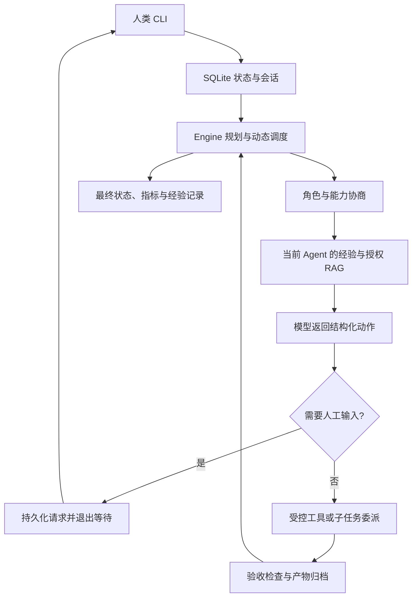

# EvoTask v0.1 架构与状态约束

## 控制层与 Agent

控制层由 Python 标准库实现：SQLite 保存运行状态、事件和会话，`Engine` 管理任务 DAG、能力协商、人工请求和预算。v0.3 增加上下游合同共享、来源交接与有界返修；见 [协作流程](collaboration.md)。当前调度串行，每个动作完成后保存状态；通过操作系统文件锁阻止两个写进程同时修改同一状态目录。

固定 Agent ID 是 `coordinator / researcher / coder / verifier`。能力由程序注册表决定，模型不能自行添加工具。规划器生成任务合同；候选 Agent 返回接单意愿、能力依据和置信度，调度器在具备所需工具的候选者中选择。置信度是模型自报启发式，尚未校准为实际成功概率。

工作 Agent 可以创建有验收条件和深度上限的子任务，暂停等待其结果。被委派的 Agent 必须与委派者不同；Verifier 不接收由其自身承担直接上游工作的验证任务。交接依赖不可变产物快照，不共享整个工作区。



## 文件系统与执行边界

```text
state/
├── state.sqlite3                  # 状态、事件、知识文档与分块索引；仅控制层访问
├── writer.lock
├── knowledge.json                 # 旧版索引备份，仅迁移一次
├── agents/
│   └── <agent_id>/
│       ├── memory.json             # 该 Agent 的私有经验
│       └── work/<run_id>/          # 唯一可挂载的代码工作区
│           └── inputs/            # 授权复制的输入，容器内只读
├── blobs/<sha256>                  # 控制层不可变快照，不挂载进容器
├── publish/<operation_id>/         # 控制层 Git 仓库，不挂载进容器
├── runs/<run_id>/status.md
└── evaluations/<batch_id>/         # 独立评测与汇总
```

LLM 会话、调度和可信文件工具在控制进程中运行；生成的任意 Python 代码只在短期 Docker 容器中运行。每个 Agent 拥有独立可执行工作区，并不是四个常驻模型进程。文件 API 拒绝路径穿越、隐藏目录、Windows 特殊路径、符号链接和重解析点；允许的文件后缀为纯文本资料、源码和内部结构化文本。

程序级 ACL 适用于 Agent 通过工具访问，不防止本机账户拥有者直接读取磁盘。CLI 面向可信本地操作者；v0.4 Web 层在签名访客会话、访问口令基础上增加了账号密码认证、可撤销登录和按账号隔离的目录，支持同服务内跨设备同步；尚未提供计费、账号配额或分布式任务队列。详见 [Web 架构与部署](webapp.md)。

## 任务与运行状态

任务状态：`pending → running → succeeded/failed`，中间可进入 `waiting_child` 或 `waiting_human`。规划拒绝重复 ID、未知依赖、循环和无法由任何角色满足的工具组合。重试保留同一任务身份，另增尝试记录，不增加完成率分母。

运行状态：`planning → running → waiting_human/succeeded/failed`。每次模型请求前持久化计数；每次工具调用前持久化 `inflight`。进程异常退出后，若存在 `inflight`，不自动重放该操作，报告结果不确定。控制器可恢复未完成的普通调度以及已持久化的人工等待。

人工请求包含请求 ID、任务 ID、动作、待验收版本、参数和时间。拒绝会终止该任务；批准只适用于该请求。删除前比对内容哈希；Git 推送使用批准时的快照；交付验收在完成时再次比对版本。已消费的请求不能再次提交。

## RAG 与经验

Web 上传原件以二进制流保存于会话目录，常见格式解析为 UTF-8 文本。知识文档、分块与词频持久化于 SQLite，检索逐块扫描，避免整份索引常驻内存。原件保留 SHA256，可通过同会话接口下载；无法提取正文的文件有明确状态且不进入片段检索。任务输入采用流式复制和分页读取，无原有上传字节上限。

知识库新增命名集合与来源元数据。任务记录所选知识库 ID，检索同时按库和 Agent 作用域筛选；旧文档迁移至默认库。

知识检索采用 BM25，中文单字／双字词项与英文词项混合。检索前按作用域过滤，片段带文档版本、行号与引用 ID。交付物中的规范引用 ID 必须来自该任务的检索或授权交接；此检查验证引用来源存在性，不替代语义上的“引用是否支持结论”。

各 Agent 分开存储经验。只有由执行记录支撑的成功检查、失败事实和协调历史会标为可检索经验；没有将模型反思自动提升为已验证修复规则。新任务按词项相关性检索自身经验并放入模型上下文，事件记录命中的经验 ID。需进一步实验判断这种上下文反馈是否带来收益。

## 失败与指标

每次失败写事件、保留有界的文本产物快照并向群组反馈。快照按内容哈希保存，修复不覆盖旧版本。任务通过声明检查后才成功；依赖失败会阻止后续任务，子任务失败仍保留在统计中。

运行指标包括总体状态、子任务完成率、端到端墙钟时间、活动时间、人工等待、调用数和步骤数。墙钟时间包含等待和进程停止期间的时间；活动时间仅统计控制器运行区间，两者不一定加总相等。活动时间预算在调度边界检查，单次网络／容器调用另有超时，可能在边界处有短暂超出。

外部评测器读取最终交付快照运行固定用例检查，另报预期行为通过率，避免把正确暂停等待人工误称为完成了整个任务。测试集版本、配置哈希和每次运行的初始记忆哈希保留于结果中。评测用例默认各自隔离，不跨用例更新经验。
