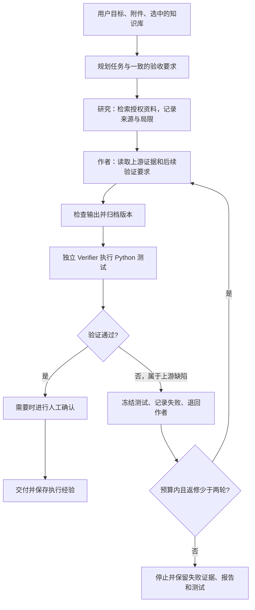

# Agent 协作、返修与个人知识库（v0.3）

## 本次问题的实际原因

失败记录显示：Researcher 的 `research_sources.md` 有公开来源链接，但作者生成的 `market_research_report.md` 没有参考来源章节或 URL。作者的任务合同只检查文件、标题和产品名称；Verifier 的合同额外要求 URL，作者执行时却看不到这项后续要求。Verifier 仅收到直接上游报告，缺少更早的来源资料。两次 `{"purpose":"act","action":{...}}` 格式返回被计入连续失败，随后真正的 Python 断言失败成为第三次失败，运行结束。

这不是 Docker 故障，也不能通过删掉 URL 断言解决。旧报告还包含未获外部数据支持的市场增长判断；格式验证通过不代表这些事实成立，需要来源和人工审阅。

## 当前协作流程

- 执行上下文包含上游任务的目标、结果，以及后续任务的完整验收要求。独立验证者不能承担直接上游作者的身份。
- 根据声明的依赖链交接祖先任务产物与来源记录，不读取无关 Agent 的私有工作区。网页检索结果、抓取页面、用户输入和知识库来源分别标记；搜索命中仅是线索，不等于支持结论的证据。
- 兼容无歧义的 `purpose/action` 包装。冲突或未知结构仍拒绝，不猜测要执行的动作；能力协商重试不沿用上次竞标结果。
- 新增 `sources` 验收类型：`{"kind":"sources","path":"report.md","policy":"url"}`。`url` 要求报告中出现已观察来源记录中的 HTTP(S) URL；`local` 接受真实检索/交接的片段引用；`any` 接受其中一种。内部资料不强制伪造公开 URL。模型应在作者合同中声明来源要求，并让后续验证遵循相同要求。
- 对 Verifier 的 Python `AssertionError`，有明确且成功的直接上游作者时自动发起返修；也可由 Verifier 发出 `request_revision`，给出上游任务 ID 和观察到的缺陷。语法错误、Docker 不可用等不会自动归咎作者。
- 原作者与受影响的后续任务重新执行。保留角色、合同、历史、全局步数/模型/时间预算；每个任务运行最多两轮返修。跨委派子任务的复杂返修暂不自动展开，明确报出原因并保留产物。
- 原验证脚本按哈希冻结，工具禁止改写/删除；复验前后再次核验脚本。控制层刷新其授权输入路径所对应的报告版本，记录旧/新产物 ID 和 SHA256；旧内容保留于归档，不要求模型改写测试里的文件路径。
- 过期报告标为 `superseded`；相关成功经验撤销可检索资格，修订后的成功以新记录保存。未通过的事实、测试输出和修复轮次保留在事件、报告与经验中。
- 机械检查先于该任务的人工确认执行。作者修订后仍须重新满足原合同中的人工验收，旧批准不能批准新版本。

## 恢复历史失败任务

刷新 Web 工作台，进入对应模式和失败任务，点击 **修复并复验**。该操作将记录的验证失败交给原作者，在剩余运行预算内继续。真实模式会调用配置的模型并消耗 API 额度；本次开发验证未重新调用用户模型，也未改写原失败报告。

该入口要求有可返修的上游、未用尽全局预算及返修次数。没有可用上游、复杂委派依赖或预算不足时，接口明确返回原因。可下载归档证据创建新任务。

## 我的知识库

1. 打开 **知识库 → 新建知识库**，填写名称和用途。可按项目创建多个库；旧资料自动归入默认的「我的知识库」。
2. 选择库，批量上传文件，或新建 Markdown/文本内容；填写可选的来源 URL、说明与 Agent 访问范围。
3. 文档设置可修改来源、说明、访问范围，或移动至其他库。Markdown/TXT 小型正文支持页面编辑后重新索引；较大文档和 PDF/Office 保留正文预览，更新内容使用重新上传，上传仍无固定字节上限。
4. 在当前库中试检索，并切换 Agent 验证作用域。检索结果保留来源 URL、原始文档名称、行号和片段 ID。
5. 回到真实模式工作台，在 **使用我的知识库** 勾选本次任务可检索的库；全部取消表示本次不使用知识库。服务器在检索工具中执行过滤，模型不能自行扩展到未选择的库。
6. 知识库可重命名。v0.4.1 起，在库选择栏右侧点击「删除知识库」，查看资料数量和名称并确认，即可连同原件、检索索引删除整个自建库；默认库提供「清空知识库」，保留库本身。确认期间内容发生变化则拒绝旧确认，需同步后重试。已有任务和归档产物保留，新任务不再可选被删除的库。相同文件名在不同库中独立保存，同库同访问范围重传会更新原文档版本。

v0.4 起知识库支持账号登录同步，同一账号跨浏览器/设备共享资料，demo/live 模式保持隔离。访客模式仍按浏览器签名会话保存，登录后可导入知识库；详见 [账号与同步](accounts.md)。

## 验证边界

新回归覆盖真实问题的模拟复现、原测试不变的修复循环、两轮上限、旧运行恢复、旧批准失效、测试篡改拒绝、来源类型、HTTP 返修授权，以及知识库 CRUD/作用域/任务选库。另以真实 Docker 运行完整缺 URL 返修流程；使用确定性测试模型，不调用付费 API。

URL 语法、来源追踪、章节存在性均不是事实正确性的充分条件；引用是否支持具体市场判断仍需实际阅读和审阅。未宣称最新模型生成或本次原始失败任务已经重新成功运行。
