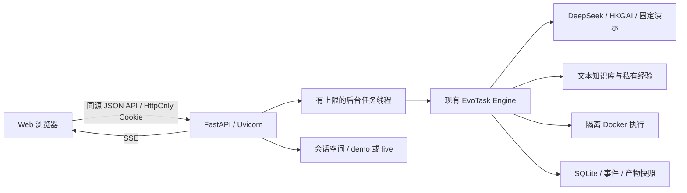

# EvoTask Web v0.4.1

本版本将现有任务引擎接入可操作的 Web 应用。前后端同源提供服务，不需要另外启动前端开发服务器。默认使用离线演示，真实模式读取服务端 `.env`，浏览器不接触模型密钥。

## 启动与体验

Windows，在项目根目录：

```powershell
.\.venv\Scripts\python.exe -m evotask serve
```

访问 http://127.0.0.1:8000 。首次安装的另一台 Windows 机器可以运行 `powershell -NoProfile -ExecutionPolicy Bypass -File .\start-web.ps1`；脚本创建环境、安装依赖并启动，执行策略放行仅作用于本次 PowerShell 进程。也可执行：

```powershell
python -m venv .venv
.\.venv\Scripts\python.exe -m pip install -e ".[web]"
.\.venv\Scripts\python.exe -m evotask serve
```

macOS/Linux 对应命令为 `python3 -m venv .venv`、`.venv/bin/python -m pip install -e '.[web]'`、`.venv/bin/python -m evotask serve`。该平台尚未在本次联调中实机验证。需要复现本次 Python 3.11 环境时，可先安装 `requirements-web.txt` 中固定的运行依赖。

本次生成的 Python 安装包为 `dist/evotask-0.4.1-py3-none-any.whl`，包含全部 Web 页面资源与 Web 演示资料，可通过 `python -m pip install "dist/evotask-0.4.1-py3-none-any.whl[web]"` 安装。配置文件和会话数据不随包发送。CLI 教学示例与 benchmark 仍保留在源代码仓库，运行 CLI 示例/评测时使用完整仓库。

推荐首次体验：

1. 保持顶部「离线演示」，点击「启动协作演示」。
2. 查看任务拆解、Researcher 向 Verifier 委派取证，以及 Coder 汇总报告的事件。
3. 点击 `report.md` 预览内容和引用；也可先下载再审阅。
4. 点击「确认通过」，观察任务完成；拒绝时保留失败结果与已有产物。
5. 去知识库上传 PDF、Word、Excel、PPT 或文本资料，尝试以不同 Agent 身份检索。
6. 去 Agent 对话试用群聊和私聊；查看 Agent 经验记录。

离线演示是固定教学任务：模型决策采用确定性 fixture；检索、文件读写、交接、引用检查与归档实际发生。它不会执行用户任意目标，也不会执行生成代码，不代表真实 LLM 性能。自定义任务和附件需切换「真实模型」，不能悄悄降级到演示。

## 个人知识库与失败返修

在知识库页新建命名库，上传资料或手动创建文档，设置来源 URL、说明和访问范围；文档设置支持编辑文本、移动资料和重新索引。真实模式工作台可选择本次使用的库，全部取消则关闭本次知识检索。顶部「登录同步」可注册个人账号，在另一浏览器/设备访问同一服务并登录即可使用相同资料。访客知识库可显式导入；demo/live 保持隔离。详见 [账号与同步](accounts.md)。

失败任务若存在可恢复的独立验证，任务详情显示「修复并复验」，将缺陷退回原作者，在剩余预算内用原测试验证修订版。新运行的对应断言失败会自动触发最多两轮返修。详情、具体问题原因与边界见 [协作与知识库说明](collaboration.md)。

## 删除或清空知识库（v0.4.1）

进入知识库页，选择目标库，点击库选择栏右侧「删除知识库」，确认资料名称和数量后删除。无需先逐个删除文档；原件与检索索引一并移除，已有任务和归档产物保留。默认库显示「清空知识库」，资料全部移除后仍可继续向默认库上传。

账号与 demo/live 隔离继续生效；另一设备在确认期间修改库或文档时，旧确认返回 409，需关闭确认窗口、同步后重试。执行任务期间不允许删除。删除成功后新任务的选库列表自动剔除对应 ID，其他设备在下次同步时看到变化。

索引和原件清理队列在同一数据库事务提交；数据库失败会完整回滚。原件若被其他程序占用，资料先停止被检索与下载，界面说明待清理状态，下次知识库管理或上传操作重试清理原件。仅清理当前空间的上传副本，不触及 CLI 原始资料或外部文件。

## 页面与功能

| 页面 | 实现能力 |
|---|---|
| 工作台 | 自定义真实任务、固定演示、任意格式、多份附件、上传进度、经验开关、交付前人工确认、示例目标、最近任务 |
| 任务记录 | 状态筛选、目标搜索、打开历史运行 |
| 任务详情 | SSE 实时状态、分工与委派、全部事件展开、验收条件、可恢复的审批/澄清、协作停止、产物与 JSON 审计导出 |
| 知识库 | 文件选择/拖放/粘贴、共享或单 Agent 作用域、同名文档版本更新、移除、带行号和引用 ID 的 BM25 检索 |
| Agent 对话 | 团队频道与四个私聊频道，持久化历史，真实 API 错误展示 |
| 经验弹窗 | 分角色查看执行结果、失败事实与证据；演示和真实记录隔离 |
| 系统状态 | 模型名称、密钥是否配置、调用预算、Docker、Git、检索服务；不发送模型调用 |

界面采用浅色与绿色主题、响应式布局、SVG 协作图、鼠标跟随光晕、状态动画、快捷查找与原生弹窗。支持键盘操作和减少动画偏好，所有资产随项目提供，无外部字体、分析脚本或 CDN。

- `Ctrl/⌘ + K`：查找页面或已有任务。
- `Ctrl/⌘ + Enter`：提交当前任务/消息表单。
- `Esc`：关闭弹窗。

## 文档上传与大文件（v0.2.1）

知识库和真实任务附件均接受任意扩展名，不设固定单文件大小、附件数量或知识文档数量上限。浏览器直接发送 File 二进制，服务端按请求流写磁盘；上传时显示百分比，完成传输后提示正在提取和索引。浏览器不将大文件整体读成字符串，也不再经 JSON/Base64 传输。

| 格式 | 处理结果 |
|---|---|
| PDF（带可提取文本层） | 按页提取正文，保留页码标记 |
| DOCX/DOCM、PPTX/PPTM、ODT/ODS/ODP | 提取正文/幻灯片文本；不执行宏或解压文件到任意路径 |
| XLSX/XLSM/XLTX/XLTM | 只读逐行读取工作表；保留单元格文本/公式，不执行公式 |
| HTML、RTF | 提取文本；HTML 排除 script/style 内容 |
| TXT、MD、CSV、JSON、日志、代码和无扩展名文本等 | 自动识别 UTF-8、带 BOM 的 UTF-16/32 及可识别的其他文本编码 |
| 图片、扫描 PDF、需密码的文档、旧版 DOC/XLS/PPT、未知二进制或损坏文件 | 原件可上传/下载，标为「仅保存原件」，不伪造正文或索引；OCR、解密和旧版 Office 转换暂未实现 |

提取结果规范化为 UTF-8 文本。知识库以 SQLite 存放分块和词频，检索逐块评分；列表只查询摘要。旧 `knowledge.json` 自动迁移一次，保留旧引用位置及原文件备份，删除后不会自动恢复。知识库同名且同作用域的上传会替换索引和原件，旧版本原件随替换移除。

任务附件在本浏览器、本模式下暂存，创建任务时复制规范化正文至各 Agent 的只读输入目录，并保留原文件名。无法提取时提供明确的缺失说明。Agent 用 `read_file` 的 `offset` / `limit` / `next_offset` 分页读取大文本；原件可从任务详情下载。输入容量不再受 `EVOTASK_MAX_FILE_BYTES` 控制，该配置仍用于生成产物的写入/归档。

“不设固定大小上限”指应用没有人为字节阈值；实际容量受磁盘、解析库内存、处理时间与网络约束，部分解析器（例如 PDF/RTF）仍会使用内存处理正文。部署反向代理时需相应调整请求体大小、请求缓冲与上传超时。上传中断或解析过程异常会清理未完成的暂存文件；成功上传但未提交任务的暂存件保留在该会话目录中。

## 运行结构



后端为 FastAPI；前端为原生 ES Modules、CSS 和 SVG。选择不依赖前端构建工具的方案，便于本课程项目安装、交付与后续打包。通过 `StaticFiles` 提供 `/assets`，生命周期管理后台执行器。实现依据：[FastAPI 生命周期](https://fastapi.tiangolo.com/advanced/events/)、[静态文件](https://fastapi.tiangolo.com/tutorial/static-files/)。

每个浏览器由签名的 HttpOnly / SameSite Cookie 识别。相同 Cookie 可在刷新和服务重启后访问原空间；清除 Cookie 或换浏览器会得到新空间。这是访客模式；v0.4 注册登录后改用服务端账号目录，清除 Cookie 后可重新登录恢复账号数据。

```text
.evotask-web/
├── session.key                     # 签名密钥，不可提交或向浏览器公开
├── accounts.sqlite3                # 账号与可撤销的登录会话
├── accounts/<用户 ID>/              # 登录账号的 demo/live 空间
└── sessions/<随机会话 ID>/
    ├── demo/                       # 独立 SQLite、知识库、工作区与归档
    └── live/                       # 同上；不继承演示经验或文档
```

Web 数据不会自动混入 CLI 的 `.evotask/` 与 `.evotask-demo/`。备份时停止服务并保存整个 `.evotask-web/`；访客恢复还依赖原浏览器 Cookie，账号用户可重新登录。勿单独丢弃或替换 `session.key`。

### 执行与恢复

API 在创建运行后立即返回 `202`，后台执行器继续工作；页面关闭不停止任务。每个会话、每种模式只允许一个写任务/对话，最多四个会话空间同时工作。多 Agent 的任务调度仍为串行，不应把后台线程数解释成 Agent 并行能力。

- 每个线程独立创建并关闭 SQLite 连接，写操作继续遵守原有文件锁。
- 待确认状态落盘；刷新或重启后可以继续审批。
- 用户选择人工确认时，控制层为每个最终输出节点强制添加 human 检查，不依赖模型自行遵从文字提示。多个最终输出节点可能需要分别批准。
- 「停止」为协作式取消，当前模型请求或 Docker 操作完成/超时后生效；保留已有快照。不会声称已经停止尚在进行的操作。
- 服务中断留下的非等待运行不会自动重放。任务详情显示「继续任务」；未完成工具调用仍按原有引擎规则记录结果不确定。
- 同空间执行期间知识库更新、第二个任务或对话返回冲突提示，避免经验与文件并发覆写。

## 对外体验与部署

当前默认只监听 `127.0.0.1`，可在本机给客户演示；尚未部署公网地址。

要让同一可信局域网中的其他终端访问，在 `.env` 设置：

```dotenv
EVOTASK_WEB_ACCESS_TOKEN=<至少24字符的随机访问口令，替换此占位符>
EVOTASK_WEB_ALLOWED_HOSTS=localhost,127.0.0.1,<服务器实际局域网IPv4地址>
```

然后启动：

```powershell
.\.venv\Scripts\python.exe -m evotask serve --host 0.0.0.0 --port 8000
```

`EVOTASK_WEB_ALLOWED_HOSTS` 填用户实际访问的主机名/IP，用逗号分隔，不能包含协议、端口、路径或通配符。浏览器打开 `http://<服务器IP>:8000`，输入访问口令；个人账号登录后同账号跨浏览器共享资料；未登录账号时保留独立访客空间。口令用于进入服务，不是 DeepSeek API 密钥。修改 `.env` 后重启服务；更换访问口令会使原有授权 Cookie 失效。

面向公网应使用受控服务器与 HTTPS 反向代理，保留 Host、禁用 SSE 缓冲。模型与 GitHub 密钥仅注入后端，不打包进静态资源。默认不信任代理头；反向代理终止 HTTPS 时，用 `--trusted-proxy <代理的实际IP>` 显式信任该代理，服务才能正确识别 HTTPS 并设置 Secure Cookie。此参数可重复，不接受通配符。反向代理需覆盖客户端传来的转发头，并限制对后端端口的直连。这部分需要根据实际部署环境配置，不能直接将本地 HTTP 端口视为已完成的公网部署。

只运行 **一个 Uvicorn worker**，不启用多进程或自动重载，以保持后台任务、并发上限和取消状态一致。正式多实例/商业多租户部署仍需外部任务队列、持久化配额、分布式速率限制与运维管理。本版服务适用于课程展示和有访问控制的小规模体验。

请求防护包含签名访客会话、账号密码及可撤销登录、与身份绑定的 CSRF 令牌、Origin/Host 校验、文件路径校验、知识作用域、下载哈希核验与 HTML 转义。二进制上传、旧版 JSON 文档/附件接口不设固定请求体大小上限；其余控制请求保留 2 MB 上限。下载限定为本会话和模式的原件或归档产物；静态目录不包含 `.env`。单空间仍最多 200 次运行；知识文档数量上限已取消。

## HTTP 接口

除会话初始化和登录外，接口需要当前浏览器的有效会话；配置访问口令时还需先登录。写操作需要 `/api/session` 返回的 `X-EvoTask-CSRF`。普通写接口使用 `Content-Type: application/json`；`POST /api/uploads` 使用原始二进制请求体（推荐 `application/octet-stream`），无需 Base64 或 multipart。业务接口支持 `?mode=demo|live`，默认 demo。

| 方法 / 路径 | 用途 |
|---|---|
| `GET /api/session` | 初始化/读取会话和 CSRF |
| `POST /api/session/login` | 工作台访问口令验证 |
| `/api/account/*` | 注册、登录、设备管理、改密、访客导入，完整接口见 [账号说明](accounts.md) |
| `GET /api/workspace` | 当前模式的任务、Agent 经验计数与后台状态 |
| `GET /api/system` | 服务端非敏感配置及环境诊断 |
| `POST /api/runs` | 创建目标/附件；`upload_ids` 为任务附件；`knowledge_base_ids` 为授权知识库 ID 列表，空列表禁用检索 |
| `GET /api/runs/{id}` | 运行状态、子任务和产物 |
| `GET /api/runs/{id}/stream` | SSE 快照/增量事件；支持 after 游标 |
| `GET /api/runs/{id}/events` | 完整事件记录 |
| `POST /api/runs/{id}/resume` | 回复请求 ID，批准/拒绝/澄清 |
| `POST /api/runs/{id}/retry` | 从已停止的失败任务创建独立新任务；JSON 包含 `request_key`（16–80 位字母、数字、下划线或连字符） |
| `POST /api/runs/{id}/continue` | 恢复未结束的中断任务 |
| `POST /api/runs/{id}/repair` | 将历史验证失败退回原作者，保留验收要求并复验 |
| `POST /api/runs/{id}/cancel` | 请求停止并归档 |
| `GET /api/runs/{id}/artifacts/{artifact}` | 产物内容；`download=true` 下载 |
| `GET /api/runs/{id}/report` | 导出 JSON 审计记录 |
| `POST /api/uploads` | 流式上传；参数 `name`、`purpose=knowledge或task`、`scope`、`mode`、`base_id`、`source_url`、`description` |
| `GET /api/uploads/{id}/download` | 哈希检查后下载当前会话/模式的原件 |
| `GET/POST /api/knowledge` | 列出文档／文本导入；支持 base_id、source_url、description |
| `GET/POST /api/knowledge/bases` | 列出／新建个人命名知识库 |
| `GET /api/knowledge/bases/{id}` | 删除预览：资料数量、前 10 个名称、revision 与是否默认库 |
| `PATCH/DELETE /api/knowledge/bases/{id}` | 重命名、修改说明／删除整库；默认库清空。删除资料须提交 delete_documents=true、预览的 expected_revision |
| `GET/PATCH /api/knowledge/{id}` | 正文预览／修改库、作用域、来源、说明，可选更新文本 content |
| `DELETE /api/knowledge/{id}` | 删除索引和该会话上传副本 |
| `GET /api/knowledge/search` | query、agent、可选 base_id 参数检索 |
| `GET /api/agents/{agent}/memory` | 查看该会话的 Agent 经验 |
| `GET/POST /api/chat` | 查看历史/发送消息，channel 指定频道；群聊 GET 可用 run_id 筛选任务协作记录 |

## 验证

```powershell
.\.venv\Scripts\python.exe -m pip install -e ".[web,test-web]"
.\.venv\Scripts\python.exe -m unittest discover -s tests -v
# 另一个终端先启动 Web；浏览器测试使用本机已安装的 Edge，无需下载 Chromium。
.\.venv\Scripts\python.exe tests\browser_smoke.py
.\.venv\Scripts\python.exe -m tests.browser_uploads
.\.venv\Scripts\python.exe -m tests.browser_knowledge
```

浏览器脚本使用独立上下文，仅操作演示模式，不调用真实模型。自动覆盖启动、刷新恢复、审批、预览、下载、知识库上传/权限过滤/删除、XSS 文本显示、私聊、快捷查找及 390px 移动布局。截图保存至被 Git 忽略的 `test-results/web/`。

v0.2.1 常规回归共 65 项：62 通过、3 跳过（2 项需显式启用 Docker，1 项受 Windows 符号链接权限影响）。本轮不重复执行未修改的 Docker 路径。新增浏览器回归使用真实 PDF/DOCX/XLSX/PPTX、6,600,000 字节 CSV、未知二进制和无扩展名文本，检查 7 份批量上传、提取状态、RAG、原件下载哈希、刷新、移动布局和任务附件选择；两个浏览器脚本均通过且无页面 JavaScript 异常。

以下为此前 v0.2.1 的验证记录：当时未再次发送付费模型请求，DeepSeek 探测曾返回 HTTP 402；这不是对当前账户额度的检查结果。HTTP 402 在界面有明确原因提示，服务层测试使用模拟故障验证单次失败即停止。

本次 v0.3 新增协作返修和个人知识库回归；浏览器覆盖知识库创建/重命名/删除、正文和来源编辑、权限检索、跨库移动、刷新恢复、移动布局及任务选库。选库提交测试截获请求，不发送真实模型调用；原有演示与多格式大文件浏览器回归通过。真实 Docker 验证缺 URL 的报告失败后，作者修订并通过完全相同的 Python 测试。

v0.3 最终常规回归共 80 项：76 通过、4 跳过（3 项 opt-in Docker、1 项 Windows 符号链接权限）。另启用新增的真实 Docker 返修用例并通过；本轮无付费模型调用。


v0.4 增加账号登录、跨浏览器资料同步、设备撤销、改密、访客库导入和编辑冲突检测。回归方法与边界见 [账号说明](accounts.md#接口与验证)。


## 失败任务重新运行与交付文件

失败任务的列表和详情提供“重新运行”：直接创建新任务，不弹二次确认。原失败记录保留，双方显示关联链接。新任务复制目标、输入快照、附件引用、知识库选择、经验记忆开关、审阅要求及历史补充回答；不复制执行进度、产物和审批结果。模型配置与预算采用当前服务配置；修改 `.env` 后需重启服务。知识库读取所选库的当前内容，删除的库或缺失的输入会明确阻止重试。

重试请求的幂等键与新任务 ID 保存在增量创建的 `retry_requests` 表中。相同键返回同一任务；同一来源已有未结束的新任务时也返回该任务。校验失败释放执行名额，调度或后台启动失败的新任务标为失败。服务进程意外退出后，页面依赖实际执行名额显示“执行已中断，可继续任务”，不会把数据库里的旧 `running` 状态当作仍有后台执行。部署仍要求单个 worker。

新任务规划的每个 `outputs` 条目包含 `path`、`title`、`kind=deliverable|process`、`order`（1–999）及可选 `summary`。真实模型返回的新规划必须包含输出声明且至少声明一项交付文件，否则拒绝该规划；旧任务不强制重新规划。任务完成必须导出其全部已声明交付文件。系统依据实际验收确定状态；规划用途不等于验收通过。作者交付物可以位于依赖链中间；测试文件只有明确声明为交付才显示在交付区。未声明文件进入过程区。

详情展示交付文件，默认折叠过程资料、历史版本和旧任务的用途未确认文件。交付文件按规划顺序展示，过程资料按稳定归档序号排列，历史版本从新到旧。同一任务的同一路径组成版本链，内容改变才增加版本；同内容的连续快照合并显示，但原 `artifacts` 数组、审计事件和按 ID 下载均保留。已验收且有效的版本优先于后来的失败快照，旧记录不会调用模型补标或改写原文件。旧归档时间优先关联已有事件，无依据时显示“时间未知”。

API 新增 `artifact_groups`、`deliverable_count`、`retry_of`、`retry_root`、`retry_children`；每条产物补充用途、显示名、下载名、归档来源、序号、时间、版本、当前版本及重复关系。原 `artifact_count` 仍为底层归档条数，列表改用 `deliverable_count`。下载名使用简短标题及版本，交付文件增加阅读顺序，例如 `01_最终报告_v2.md`、`研究笔记_v1.md`。仅在重名时增加任务序号或副本序号，保留扩展名；产物 ID 仅用于接口定位，不出现在显示名和下载名中。预览标题与下载名一致。内部路径、代码导入和交接路径不变。下载代码单文件时提示还原文件名及目录后再组合运行。

新增回归：

```powershell
.\.venv\Scripts\python.exe -m unittest tests.test_retry_outputs -v
# 对独立测试服务执行，state-dir 必须对应该服务的数据目录；仅新建演示会话。
.\.venv\Scripts\python.exe tests\browser_retry_outputs.py --url http://127.0.0.1:8001 --state-dir test-results/feature-state
```

2026-11-14 本地真实验收使用当时 `.env` 的 DeepSeek 配置（`deepseek-v4-pro`），未使用 HKGAI。场景一的原失败记录为人工注入、模型调用 0 次；通过页面点击重新运行后，新任务独立调用模型 9 次，生成平方和实现和独立测试并通过实际 Docker 检查。场景二调用 15 次，两个任务分别生成内容不同的 `report.md`（过程笔记和交付说明），按声明顺序展示说明与 `stats.py`，Docker 验收通过。版本和失败快照回归另用确定性夹具覆盖，不把夹具宣称为真实模型产物。完整本地记录见被 Git 忽略的 `test-results/feature-live/summary.json` 和两份审计 JSON；不包含 API 密钥。


## 团队群聊与任务协作动态

Agent 对话使用气泡布局：你的消息在右侧，Agent 的消息在左侧，显示头像、角色、接收者、日期与时间。团队群聊结合普通对话和真实执行事件，展示 Coordinator 分配任务、被选中的 Agent 接收任务、子任务委派、资料交接、完成或失败反馈及人工确认。标记为“分配任务”“已接收任务”等的卡片由控制器根据实际事件生成，属于执行状态展示，不冒充额外的模型聊天；不会为了“收到”等状态增加模型调用。

旧执行事件可直接展示，不改写历史消息或重新调用模型。群聊只合并当前用户、当前模式的共享记录；私聊仍按 Agent 隔离。消息接口补充真实 `created` 时间；群聊卡片包含 `source`（`chat` / `execution`）、`kind`、`recipient`、`run_id` 及任务信息。群聊显示最近 200 条，可用任务筛选单独查看协作记录，并跳转任务详情。筛选任务时是只读记录，切回全部对话后可发言。

聊天约每 2.5 秒同步消息；输入草稿不阻止协作动态刷新，刷新保留草稿与当前阅读位置。停留底部时跟随新消息，向上查看历史时显示“查看新消息”按钮。普通群聊发言仍由 Coordinator 回复；私聊由对应 Agent 回复；执行新任务仍从工作台发起。

```powershell
.\.venv\Scripts\python.exe -m unittest tests.test_conversations tests.test_retry_outputs -v
# state-dir 指向正在运行的独立测试服务。脚本只使用新建会话与离线演示。
.\.venv\Scripts\python.exe tests\browser_conversations.py --url http://127.0.0.1:8001 --state-dir test-results/readable-chat-state
```

浏览器回归覆盖实际演示任务的分配、接收、交接、时间戳、中文及长路径换行、草稿保留、阅读位置保留、任务筛选、私聊隔离、HTML 转义、桌面／平板／手机布局，以及简化命名后的预览与真实下载。


## 任务协作网络

任务详情以 Coordinator、Researcher、Coder、Verifier 四个稳定节点展示当前任务关系。首页保留静态团队概览，不跟随某次任务。网络仅使用已有任务、产物、事件和执行状态，不添加模型请求、公共 API 或数据库字段。

虚线表示规划关系与任务依赖，实线表示实际发生的分配、委派、交接或返修反馈。实际任务执行者以 `owner` 和对应事件为准；尚未分配的角色标为“预定”。同方向关系合并并显示数量，反向关系用独立弧线。同 Agent 内的衔接只在节点详情显示。历史记录不足以确定交接方或返修接收方时，不猜测或补造关系。

点击节点查看任务目标、各项状态和内部衔接，可定位现有子任务详情或查看经验记忆；点击箭头或下方关系列表查看相关任务、文件、时间和反馈。Coordinator 没有独立执行子任务但已发生调度时显示“已安排分工”，避免误标为未参与。

只有后台正在执行且整项任务未暂停、取消或结束时，`running` 子任务所属节点才显示执行高亮与呼吸动效；规划阶段单独高亮 Coordinator。待确认、等待子任务、失败、完成和执行中断均有静态图标与文字。新到达且发生在最近 5 秒内的分配、交接或返修事件，沿相应箭头播放一次约 1.3 秒的流动效果。初次载入历史、重复 SSE、较旧的断线补发事件不重播；断线期间暂停动效并显示等待同步。

网络局部更新，SSE 不拆卸已有网络节点和祖先容器，不重启未变更节点的动画，保留选中的详情。手机和窄容器使用纵向布局；箭头坐标依据实际节点边界测量。支持键盘选择节点和关系；系统减少动态效果时关闭动画、保留静态状态。

```powershell
node tests/test_network.mjs
.\.venv\Scripts\python.exe -m unittest tests.test_network -v
# state-dir 必须对应所运行的独立测试服务；脚本不调用付费模型。
.\.venv\Scripts\python.exe tests\browser_network.py --url http://127.0.0.1:8001 --state-dir test-results/network-state
```

浏览器测试先执行真实离线演示，再使用明确标注的人工状态与 SSE 夹具验证：任务关系、实际执行者、节点和动画保留、重复事件、断线恢复、任务定位、经验入口、暂停与终止状态、减少动效及桌面／平板／手机布局。已有 DeepSeek 审计记录另作关系映射验证，不重新调用模型。
